# Motifku: Aplikasi Custom Desain & Katalog Motif untuk UMKM Kreatif Nusantara

> **Custom Design, Made for you.**
> Karya lomba **UI/UX Design Competition INTECHFEST 2026** (tema: *Digital Evolution: From Ideas to Innovation*)

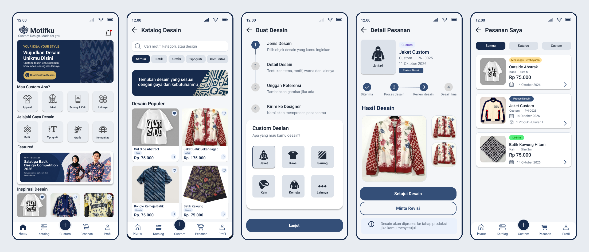
*(Preview sebagian layar aplikasi: Beranda, Katalog, Buat Desain, Review Desain, dan Pesanan Saya)*

---

## 🔗 Tautan Penting (Quick Links)

- 🎨 **Prototipe Interaktif (Figma)**: [tempel tautan view/prototype publik]
- 📐 **File Desain (Figma View)**: [tempel tautan Figma]
- 📄 **Poster / Frame Utama (PDF)**: https://drive.google.com/file/d/11p0H4tsopymUcsmmgVXCh6yCp1TPYpQa/view?usp=drive_link
- 🗂️ **Repositori Seluruh Layar (PNG)**: https://github.com/dmarhexa/Motifku-UIUX-Apk
- 📸 **Profil UMKM yang Diangkat (Instagram)**: https://www.instagram.com/ajisetyansa/

---

## 👤 Identitas Peserta

- **Nama Peserta / Tim**: Damar Bima Sahika, Muhammad Faaliq Ichsan
- **Asal Universitas / Sekolah**: UIN Salatiga
- **Cabang Lomba**: UI/UX Design (INTECHFEST 2026)
- **Nama Aplikasi**: Motifku
- **Platform**: Aplikasi mobile (Android)
- **Perangkat Lunak Desain**: Figma

---

## 📝 Deskripsi Singkat

**Motifku** adalah aplikasi desain mandiri untuk **desainer batik independen yang baru merintis usahanya sendiri**. Aplikasi ini menjadi etalase karya sekaligus ruang kerja bersama pelanggan, yang menghubungkan **pelanggan** dengan **UMKM kreatif di bidang fesyen dan tekstil** (desainer batik, pengrajin, konveksi, dan usaha sablon). Rancangan ini juga dapat dipakai oleh UMKM sejenis. Aplikasi menyediakan dua jalur pembelian dalam satu tempat:

1. **Katalog Desain**: produk siap beli (kaos, kemeja, jaket, sarung, kain) yang dikelompokkan berdasarkan gaya **Batik, Grafis, Tipografi, dan Komunitas**.
2. **Custom Desain**: pelanggan memesan desain sendiri melalui alur 4 langkah. Desainer UMKM mengerjakan, lalu pelanggan me-review hasilnya sebelum produksi.

**UMKM yang diangkat:** usaha **desain batik custom milik [@ajisetyansa](https://www.instagram.com/ajisetyansa/), seorang desainer independen di sekitar Salatiga**, yang sebelumnya bekerja di perusahaan dan kini merintis usaha mandiri. Ia membuat batik custom, misalnya motif dari nama kota, nama organisasi, hingga logo instansi dan komunitas, serta terpilih sebagai **Top 10 Designer pada Salatiga Batik Design Competition 2026**. Saat ini ia mempromosikan karya dan menerima pesanan lewat media sosial dan pesan pribadi, sehingga belum punya sistem sendiri untuk portofolio, pesanan, revisi, dan pembayaran. Motifku dirancang untuk mengisi kebutuhan itu. Konteks ini tampak pada banner *Featured* di beranda aplikasi.

Nama *Motifku* berasal dari kata "motif", identitas visual yang melekat pada batik, tipografi, grafis, hingga seragam komunitas. Akhiran "-ku" menegaskan bahwa desain yang dihasilkan bersifat personal.

---

## 💡 Latar Belakang Masalah & Solusi

### Rumusan Masalah

1. **Pemesanan custom masih manual dan tidak terstruktur.** Pesanan masuk lewat media sosial dan pesan pribadi. Konsep, ukuran, warna, dan referensi gambar disampaikan lewat chat yang tercecer, sehingga mudah terjadi salah paham.
2. **Proses revisi tidak transparan dan sulit dibatasi.** Pelanggan sulit memantau tahap pengerjaan. Menurut pengalaman desainer yang menjadi acuan, pelanggan bisa meminta revisi berkali-kali dan akhirnya kembali memilih desain awal, sehingga waktu dan tenaga desainer terkuras.
3. **Etalase digital UMKM terbatas.** Produk bermotif, terutama batik dan desain komunitas, belum punya wadah khusus yang rapi dan mudah dicari.
4. **Pembayaran dan status pesanan kurang jelas.** Pelanggan sering tidak tahu apakah pesanannya sudah dibayar, sedang diproses, atau sudah dikirim.
5. **Kesulitan menemukan inspirasi desain.** Pelanggan baru tidak tahu harus mulai dari mana saat ingin membuat desain sendiri.
6. **Desainer independen yang baru merintis belum punya sistem mandiri.** Portofolio, pesanan, revisi, dan pembayaran tersebar di berbagai tempat dan bergantung pada platform media sosial, tanpa wadah milik sendiri yang profesional.

### Tujuan & Solusi yang Ditawarkan

**Tujuan:** menyediakan satu aplikasi yang memudahkan UMKM kreatif menerima pesanan katalog maupun custom secara terstruktur, serta memudahkan pelanggan mewujudkan desainnya dengan alur yang jelas dan transparan.

| Masalah | Solusi di Motifku |
|---|---|
| Pemesanan custom tidak terstruktur | **Wizard 4 langkah** (Jenis ➔ Detail ➔ Referensi ➔ Kirim) dan layar **Konfirmasi Pesanan** dengan estimasi harga |
| Revisi tidak transparan | **Pelacak status** 4 tahap, plus opsi **Setujui Desain** atau **Minta Revisi** dengan catatan dan referensi tambahan |
| Etalase terbatas | **Katalog Desain** dengan pencarian, filter kategori, dan **Favorite** |
| Pembayaran/status tidak jelas | **Label status berwarna**, **Riwayat Pesanan**, dan **Notifikasi** per kategori |
| Sulit mencari inspirasi | **Jelajahi Gaya Desain**, **Featured**, dan **Inspirasi Desain** di beranda |

---

## ✨ Daftar Fitur Utama & Cara Penggunaan (User Flow)

> Demonstrasi dilakukan langsung melalui prototipe Figma di laptop, mengikuti dua alur utama: **Custom Desain** (nomor 3 s.d. 5) dan **Beli dari Katalog** (nomor 2 dan 6).

### 1. Beranda (`Home`)
- **Fungsi:** Pintu masuk aplikasi. Menyediakan tombol cepat **Buat Custom Desain**, pilihan *Mau Custom Apa?* (Apparel, Jaket, Sarung & Kain, Lainnya), *Jelajahi Gaya Desain* (Batik, Tipografi, Grafis, Komunitas), banner *Featured*, dan *Inspirasi Desain*.
- **Cara Penggunaan (Alur):** `Buka Aplikasi` ➔ `Pilih kategori / gaya desain` atau `Ketuk Buat Custom Desain` ➔ `Masuk ke Katalog atau wizard Custom`

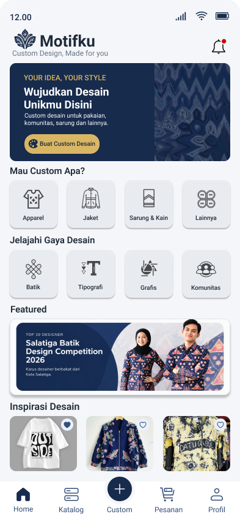

### 2. Katalog Desain & Favorite (`Katalog`)
- **Fungsi:** Menjelajah produk siap beli dengan pencarian dan filter **Semua / Batik / Grafis / Tipografi / Komunitas**. Setiap kartu menampilkan nama, kategori, harga, dan ikon favorit.
- **Cara Penggunaan (Alur):** `Buka Katalog` ➔ `Cari atau pilih filter` ➔ `Ketuk ikon hati untuk menyimpan ke Favorite` ➔ `Ketuk panah untuk memesan`

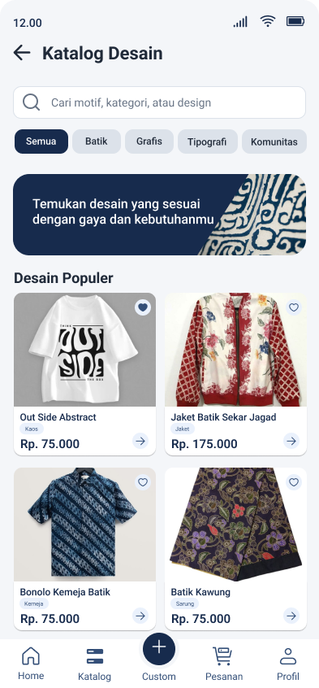 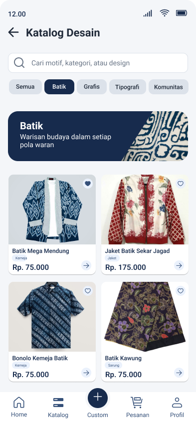 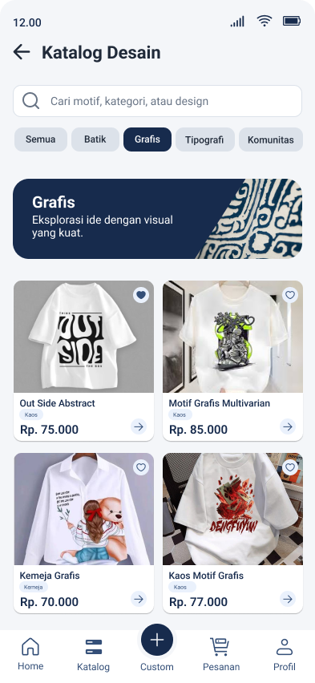 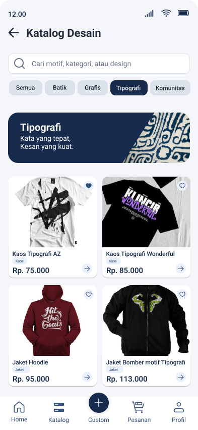 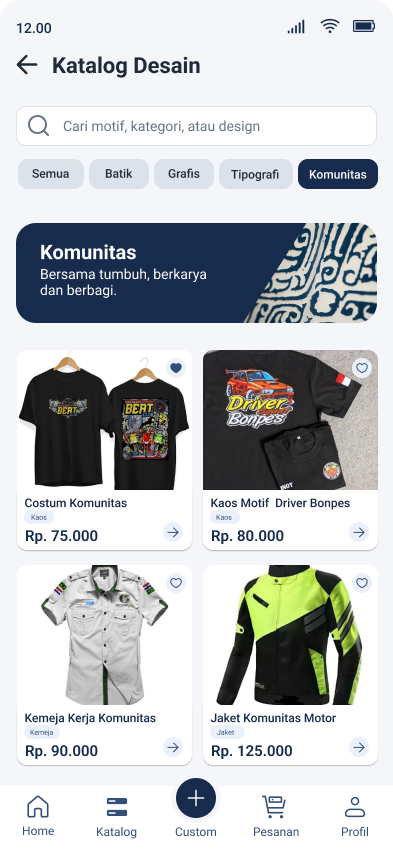 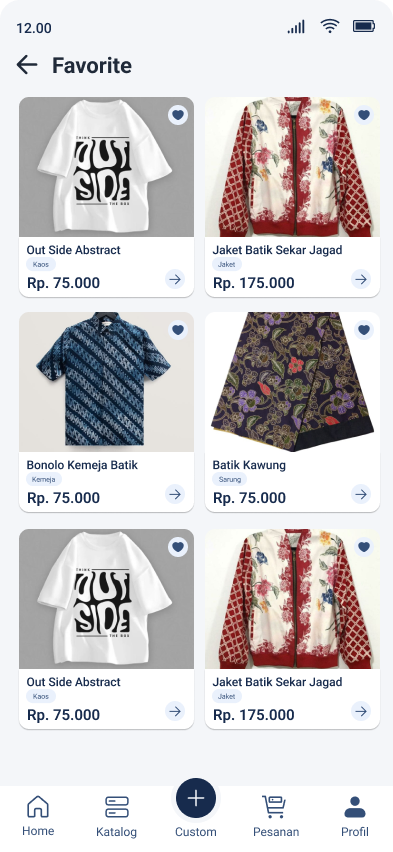

### 3. Buat Custom Desain, 4 Langkah (`Custom`)
- **Fungsi:** Mengumpulkan brief desain secara bertahap: **Jenis** (jaket, kaos, sarung, kain, kemeja, lainnya), **Detail** (konsep, warna utama, ukuran S sampai XXXL, jumlah), **Referensi** (unggah JPG/PNG maks 10 MB dan catatan opsional), lalu **Konfirmasi Pesanan** dengan estimasi harga.
- **Cara Penggunaan (Alur):** `Ketuk tombol + Custom` ➔ `Pilih jenis` ➔ `Isi konsep, warna, ukuran, jumlah` ➔ `Unggah referensi` ➔ `Periksa ringkasan` ➔ `Kirim Permintaan Desain`

   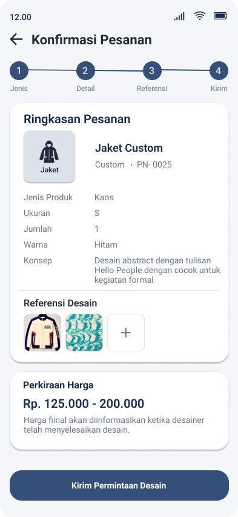

### 4. Pelacakan Status, Review & Revisi Desain (`Detail Pesanan`)
- **Fungsi:** Menampilkan progres 4 tahap (**Diterima ➔ Proses desain ➔ Review desain ➔ Desain final**). Setelah desainer mengirim hasil, pelanggan dapat **menyetujui desain** atau **meminta revisi** dengan catatan wajib dan referensi tambahan.
- **Cara Penggunaan (Alur):** `Buka Detail Pesanan` ➔ `Pantau tahap` ➔ `Lihat Hasil Desain` ➔ `Setujui Desain` atau `Minta Revisi` ➔ `Kirim Revisi` ➔ `Menunggu desain baru`

   

### 5. Pembayaran (`Pembayaran`)
- **Fungsi:** Ringkasan biaya (harga produk, ongkir, total) dan pilihan metode: **Transfer Bank** (BRI, Mandiri, BCA, BNI), **E-Wallet** (OVO, DANA, GoPay), atau **QRIS**. Pada pesanan custom, pembayaran baru muncul **setelah desain disetujui**.
- **Cara Penggunaan (Alur):** `Lanjut ke Pembayaran` ➔ `Pilih metode` ➔ `Bayar Sekarang` ➔ `Konfirmasi & Bayar` pada dialog

 

### 6. Pesanan Katalog, Pesanan Saya & Riwayat (`Pesanan`)
- **Fungsi:** Memantau semua pesanan. **Pesanan Saya** memakai filter Semua/Katalog/Custom, sedangkan **Riwayat Pesanan** memakai filter Semua/Diproses/Dikirim/Selesai. Status dibedakan warna (Menunggu Pembayaran, Proses Desain, Dikirim, Selesai).
- **Cara Penggunaan (Alur):** `Ketuk menu Pesanan` ➔ `Pilih filter` ➔ `Buka detail pesanan` ➔ `Bayar Sekarang` bila statusnya menunggu pembayaran ➔ `Pantau hingga Selesai`

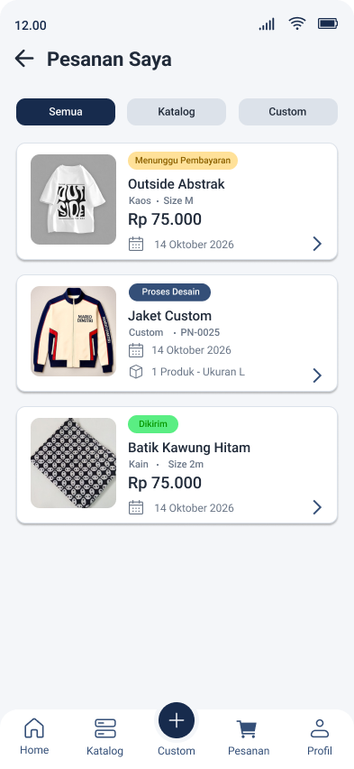   

### 7. Notifikasi (`Notifikasi`)
- **Fungsi:** Pusat pemberitahuan dengan filter Semua/Pesanan/Desain/Pembayaran, dikelompokkan *Hari Ini* dan *Kemarin*, lengkap dengan tautan aksi langsung (Lihat Desain, Bayar Sekarang, Lihat Status) dan tombol *Tandai semua dibaca*.
- **Cara Penggunaan (Alur):** `Ketuk ikon lonceng` ➔ `Pilih kategori` ➔ `Ketuk tautan aksi` ➔ `Langsung menuju layar terkait`

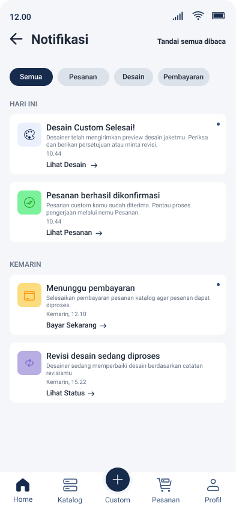

### 8. Profil, Pengaturan & Pusat Bantuan (`Profil`)
- **Fungsi:** Mengelola **Data Diri** (nama, email, telepon, tanggal lahir, jenis kelamin, alamat), **Pengaturan** (ubah password, notifikasi, bahasa, hapus akun, versi aplikasi), dan **Bantuan** (FAQ, panduan pengguna, kontak, laporkan masalah, kebijakan privasi, syarat & ketentuan).
- **Cara Penggunaan (Alur):** `Ketuk menu Profil` ➔ `Pilih Data Diri / Riwayat / Favorite / Bantuan / Pengaturan` ➔ `Ubah atau baca informasi`

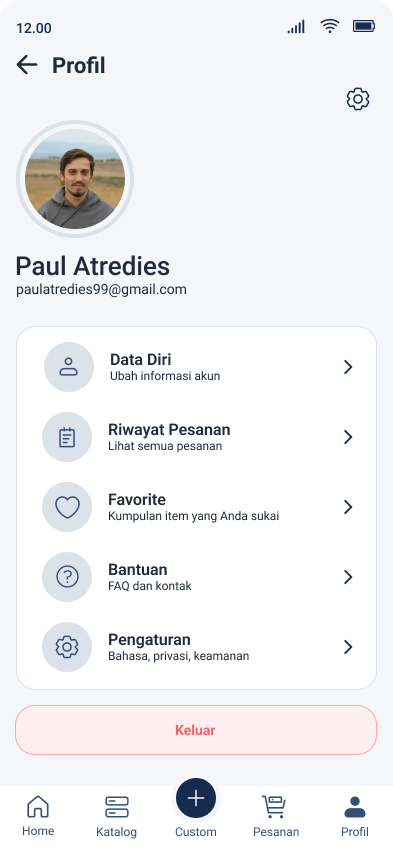 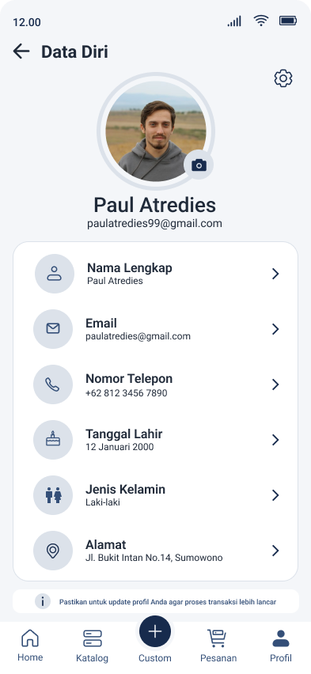 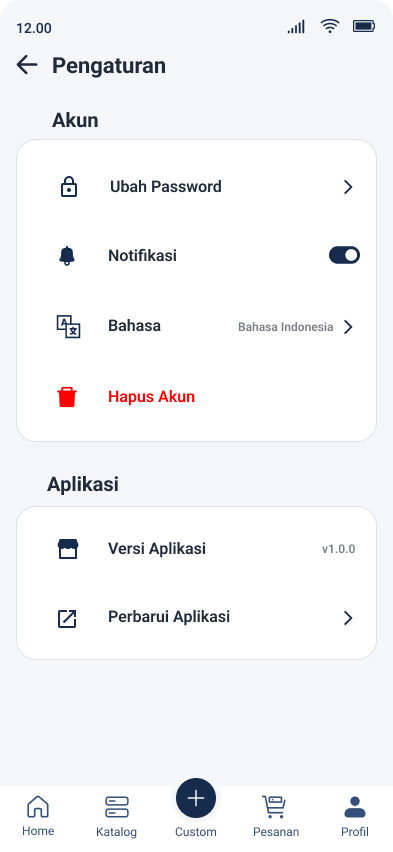 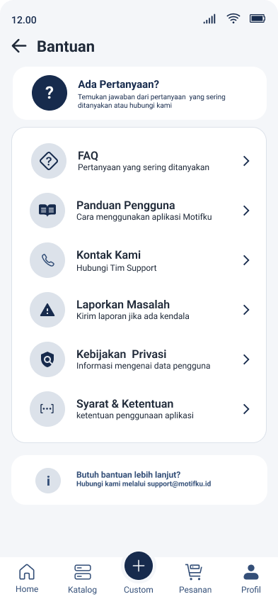

---

## 🧑‍🤝‍🧑 Target Pengguna (User Persona)

**Persona 1: Pelanggan Personal.** Anak muda dan mahasiswa (±17–30 tahun) yang ingin pakaian beridentitas sendiri, misalnya kaos bertipografi, jaket motif batik, atau kemeja formal bermotif. Terbiasa belanja dan membayar lewat ponsel (e-wallet, QRIS). *Kebutuhan:* proses mudah, hasil bisa dipantau, harga jelas di awal.

**Persona 2: Pelanggan Komunitas / Organisasi.** Komunitas, klub, dan kelompok kerja yang memesan seragam atau jaket komunitas. *Kebutuhan:* menyampaikan konsep dan referensi dengan rapi, serta menyetujui desain sebelum produksi.

**Persona 3: Pelaku UMKM (Desainer / Pengrajin), pengguna utama yang diangkat.** Desainer batik independen yang baru merintis usaha mandiri dan menerima pesanan custom, serta pelaku konveksi dan sablon dengan kebutuhan serupa. *Kebutuhan:* menerima brief yang lengkap sejak awal, mengelola revisi dengan tertib, dan memiliki etalase profesional milik sendiri.

---

## 🎨 Sistem Desain (Design System) & Penerapan Prinsip UI/UX

### 1. Identitas & Keunikan Visual (Branding)
- **Logo & tagline:** ornamen daun/motif dengan tagline *"Custom Design, Made for you"*.
- **Nuansa:** biru navy tua yang tenang dan formal, dipadu aksen emas pada elemen penting. Kesan yang dibangun: elegan, tepercaya, dan berakar pada nuansa batik. Banner bertekstur motif batik dipakai di Beranda dan Katalog.
- **Pembeda:** satu aplikasi menggabungkan **katalog siap beli** dan **custom desain berbasis review**, dengan kurasi lokal (batik) sekaligus gaya modern (grafis, tipografi, komunitas).

### 2. Palet Warna (Color Palette)

| Peran Warna | Pratinjau & Kode Hex | Penggunaan pada UI |
|---|---|---|
| **Primary Navy** |  | Banner, ikon navigasi aktif, judul, tombol penting |
| **Secondary Blue** |  | Tombol utama (Lanjut, Bayar), stepper aktif, status *Proses Desain* |
| **Accent Gold** |  | Tombol *Buat Custom Desain* dan aksen sorotan |
| **Background** |  | Latar belakang layar |
| **Surface** |  | Ubin kategori dan chip filter |
| **Card** |  | Kartu produk dan ringkasan |
| **Text** |  | Teks judul dan isi |
| **Status: Menunggu** |   | Label *Menunggu Pembayaran* dan tombol *Bayar Sekarang* |
| **Status: Berhasil** |   | Label *Dikirim / Selesai* dan *Desain Disetujui* |
| **Status: Bahaya** |   | Tombol *Keluar* dan *Hapus Akun* |

### 3. Tipografi & Hierarki Visual (Typography)
- Menggunakan huruf **sans-serif modern** yang bersih dan mudah dibaca di layar ponsel.
- Hierarki jelas: judul halaman tebal dan besar, subjudul menengah, keterangan dan label berukuran kecil dengan warna lebih lembut.

### 4. Prinsip UX & Usability yang Diterapkan
- 🧭 **Konsistensi navigasi**: bilah navigasi bawah berisi 5 menu (Home, Katalog, Custom, Pesanan, Profil), dengan tombol **Custom** di tengah sebagai aksi utama.
- 🪜 **Progressive disclosure**: form custom dipecah menjadi 4 langkah dengan indikator progres agar tidak membebani pengguna.
- 👁️ **Visibilitas status sistem**: stepper dan label status berwarna selalu menunjukkan posisi pesanan, ditambah notifikasi.
- 🛡️ **Kontrol pengguna & pencegahan kesalahan**: pembayaran custom setelah desain disetujui, opsi minta revisi, dialog konfirmasi sebelum bayar, kolom wajib bertanda, serta batas format dan ukuran unggahan ditampilkan di muka.
- ♿ **Keterbacaan & aksesibilitas**: kontras warna teks terhadap latar yang cukup, ikon disertai teks label, dan target sentuh yang cukup besar.

---

## 📈 Evaluasi & Proyeksi Dampak

### Kendala dalam Proses Perancangan
1. **Menyeimbangkan dua jalur pembelian** (katalog dan custom) agar tidak membingungkan. Solusi: tombol **Custom** di tengah navigasi bawah sebagai aksi utama, sementara Katalog tetap menu tersendiri.
2. **Menyederhanakan form custom** yang memuat banyak informasi. Solusi: dipecah menjadi 4 langkah dengan indikator progres.
3. **Menjaga transparansi harga custom** karena harga akhir baru pasti setelah desain selesai. Solusi: menampilkan **rentang estimasi** di awal, dan pembayaran dilakukan setelah desain disetujui.
4. **Merancang alur revisi** yang jelas bagi pelanggan tanpa menambah beban desainer. Solusi: catatan revisi wajib dan lampiran referensi opsional.
5. **Menjaga konsistensi visual** di puluhan layar (warna, komponen, label status) sambil memberi ruang bagi foto produk yang beragam.

### Proyeksi Dampak bagi UMKM Target
- **Brief lebih lengkap sejak awal**, sehingga komunikasi bolak-balik berkurang dan pengerjaan lebih efisien.
- **Proses lebih rapi dan terdokumentasi**: pesanan, revisi, dan pembayaran terekam dalam satu sistem.
- **Jangkauan pasar lebih luas** lewat katalog digital yang menampilkan batik dan desain lokal di luar pelanggan sekitar.
- **Kepercayaan pelanggan meningkat** karena status pesanan transparan dan pembayaran dilakukan setelah desain disetujui.
- **Mendukung pelestarian budaya** dengan menempatkan motif batik sebagai kategori utama yang mudah dijangkau generasi muda.

### Rencana Pengembangan
- Validasi lewat uji kegunaan (usability testing) dengan pelaku UMKM dan calon pelanggan.
- Dasbor khusus UMKM untuk mengelola pesanan masuk, revisi, dan katalog produk.
- Pelacakan pengiriman, ulasan produk, dan fitur chat langsung dengan desainer.

---

*Dibuat untuk INTECHFEST 2026 – UI/UX Design Competition, UIN Salatiga.*
